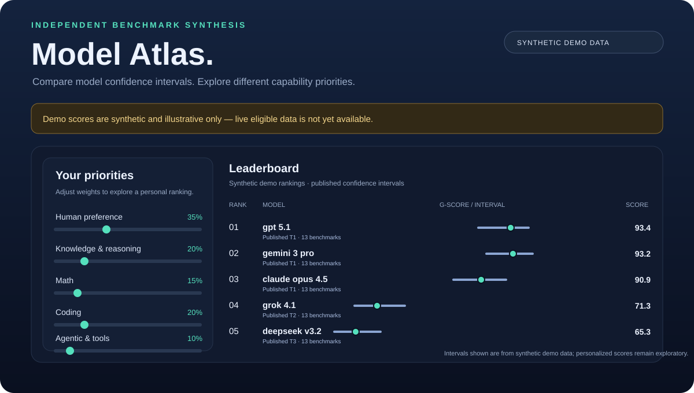

# model-hierarchy

**One number per model, every day: a reality-anchored tier hierarchy of frontier models,
aggregated from LMArena, OpenRouter usage, GPQA, LiveBench, SEAL, AIME, HMMT, SWE-bench
Verified, LiveCodeBench, Terminal-Bench and Tau²-bench.**

> Which models are *comprehensively* better than the rest right now — not per-benchmark noise,
> not vibes: a declared-weight aggregate over 5 capability pillars, with confidence intervals,
> tier groupings, and pairwise "confidently better" probabilities.

📖 **The methodology — every weight, every formula, every tradeoff — is specified in
[METHODOLOGY.md](METHODOLOGY.md).** This README shows you how to run it.

## Refresh the live leaderboard

[**Run a full refresh now →**](https://github.com/Nan0pk/model-hierarchy/actions/workflows/daily.yml)

This opens the repository's `daily` workflow. Select **Run workflow** with branch `main` to run
fetch → validate → aggregate → render → tests → auto-commit. When the run succeeds, reload the
[dashboard](https://nan0pk.github.io/model-hierarchy/dashboard/) or README. GitHub requires an
authenticated owner/contributor to start Actions; a static Pages button cannot safely carry a
GitHub token or dispatch jobs directly.

The refresh uses trusted configured sources only. If fresh data does not cover at least five
benchmarks across three pillars, the honest result is still an empty ranked hierarchy—not synthetic
scores presented as current.

## Quickstart

```bash
pip install -r requirements.txt

python -m hierarchy validate   # config ↔ methodology consistency check
python -m hierarchy demo       # end-to-end run on bundled synthetic data (no network)
pytest -q                      # contract tests: weights pinned to METHODOLOGY.md
```

To produce a **real** leaderboard:

```bash
python -m hierarchy fetch --allow-missing   # try live sources (best-effort, soft-fail)
python -m hierarchy run                     # fetch + aggregate + render README/JSON/CSV
```

Automatic adapters currently cover LMArena and OpenRouter, plus Vals AI's independently evaluated
GPQA Diamond, MMLU-Pro, SWE-bench Verified, and LiveCodeBench tables. Vals marks these benchmark boards
archived because it no longer reruns saturated benchmarks on new model releases; each snapshot uses
the evaluation date published on the page (not the scrape date), and the standard 120-day cutoff
excludes older results. SWE-bench is restricted to the fixed `Mini-SWE-agent` harness. Source URLs,
evaluation dates, provider and harness qualifications are retained in the generated JSON and shown
in the dashboard's **Benchmark sources and qualifications** section.

Several metrics remain intentionally manual: LiveBench 2.0 no longer matches the historical metric
in these weights; SEAL's legacy average has no confirmed current endpoint; AIME/HMMT/MATH-500 are
fixed contests/sets without a single comparable live leaderboard; Terminal-Bench mixes agent
harnesses; and Tau² lacks a stable public machine-readable board. Each adapter/manual status is
reported by `python -m hierarchy validate` and `python -m hierarchy fetch` so a missing integration
is visible instead of silently skipped. Never scrape a page's retrieval date as benchmark freshness.

Any automatic source that fails (endpoint moved, schema changed) is logged and skipped — the
hierarchy is computed from valid, sufficiently fresh data only. The **guaranteed** input path is
[`data/manual/scores.csv`](data/manual/scores.csv): provide `benchmark,model,score,as_of,source,notes`
for a methodology-compatible score and the pipeline runs offline. Scrapers rot; manual drops never do.

## Weights at a glance (v1.1.0)

| Pillar | Weight | Benchmarks (global weights) |
|---|---|---|
| Human Preference | **0.35** | LMArena style-controlled Elo (0.25), OpenRouter token share (0.10) |
| Knowledge & Reasoning | **0.20** | GPQA Diamond (0.08), MMLU-Pro (0.06), LiveBench (0.03), Scale SEAL (0.03) |
| Math | **0.15** | AIME 2025 (0.08), HMMT Feb 2025 (0.04), MATH-500 (0.03) |
| Coding | **0.20** | SWE-bench Verified (0.10), LiveCodeBench (0.07), Terminal-Bench coding share (0.03) |
| Agentic | **0.10** | Tau²-bench (0.06), Terminal-Bench agentic share (0.04) |

Aggregation: Borda + clipped min-max normalization per benchmark → arithmetic mean within
pillars → **weighted geometric mean across pillars** (generalists win, specialists place) →
coverage penalty for missing data → 2,000-rep parametric bootstrap → tiers + pairwise
P(A ≻ B). Full spec: [METHODOLOGY.md](METHODOLOGY.md).

Key properties:

- **llmstat is a mirror, not a voice** — it republishes the same underlying benchmarks, so
  scoring it separately would double-count everything (METHODOLOGY.md §4). Use it to source
  manual drops.
- **Tiers, not fake precision** — same tier = statistically indistinguishable on current data.
- **Reproducible** — raw snapshots are committed; every output embeds a `config_hash`.

## Example output (synthetic demo data)

<!-- demo-leaderboard:start -->

> ⚠️ **Synthetic demo data** (see `demo/scores.csv`) — illustrates the output shape only. Run `python -m hierarchy run` for a real leaderboard.

Tier hierarchy (G-score 0-100) — generated 2026-11-01 19:12 UTC — SYNTHETIC DEMO DATA
────────────────────────────────────────────────────────────────
T1 │ claude opus 4.5 · gemini 3 pro · gpt 5.1
T2 │ grok 4.1
T3 │ deepseek v3.2
T4 │ kimi k2.5
T5 │ glm 4.7 · qwen3 max
T6 │ gpt 5 mini
T7 │ llama 4 maverick · minimax m2.5 · mistral large 3
────────────────────────────────────────────────────────────────
Same tier = statistically indistinguishable on current data (METHODOLOGY.md §11).

| # | Model | Tier | G | 95% CI | Hum. | Know. | Math | Code | Agent | Cov. | Flags |
|---|-------|------|---|--------|---|---|---|---|---|------|-------|
| 1 | `gpt 5.1` | T1 | **93.4** | 89.8–95.6 | 91 | 97 | 94 | 96 | 94 | 100% | – |
| 2 | `gemini 3 pro` | T1 | **93.2** | 90.5–95.0 | 96 | 97 | 100 | 89 | 84 | 100% | – |
| 3 | `claude opus 4.5` | T1 | **90.9** | 87.4–94.0 | 93 | 86 | 84 | 95 | 100 | 100% | – |
| 4 | `grok 4.1` | T2 | **71.3** | 67.0–75.7 | 69 | 75 | 75 | 70 | 71 | 100% | – |
| 5 | `deepseek v3.2` | T3 | **65.3** | 61.4–68.9 | 68 | 65 | 69 | 65 | 59 | 100% | – |
| 6 | `kimi k2.5` | T4 | **59.1** | 54.6–63.8 | 56 | 56 | 61 | 69 | 58 | 100% | – |
| 7 | `glm 4.7` | T5 | **50.5** | 46.0–55.6 | 50 | 46 | 53 | 53 | 48 | 100% | – |
| 8 | `qwen3 max` | T5 | **47.8** | 43.6–52.0 | 50 | 45 | 48 | 46 | 42 | 100% | – |
| 9 | `gpt 5 mini` | T6 | **39.6** | 36.3–42.8 | 52 | 32 | 39 | 34 | 33 | 100% | – |
| 10 | `minimax m2.5` | T7 | **29.8** | 25.9–34.3 | 32 | 22 | 34 | 33 | 26 | 96% | – |
| 11 | `mistral large 3` | T7 | **12.4** | 8.8–15.3 | 14 | 11 | 13 | 11 | 11 | 94% | – |
| 12 | `llama 4 maverick` | T7 | **5.0** | 5.0–7.7 | 5 | 5 | 5 | 5 | 5 | 100% | – |

<!-- demo-leaderboard:end -->

*( regenerate with `python -m hierarchy demo` — numbers are synthetic, see
`demo/DATA_IS_SYNTHETIC.md` )*

## Explore the leaderboard

[Open the Model Atlas dashboard](https://nan0pk.github.io/model-hierarchy/dashboard/) (published via GitHub Pages). It displays only eligible live results by default; if none are available, it explains the eligibility gap rather than presenting demo scores as real. Use `?demo=1` to opt into the clearly labeled synthetic demo. GitHub READMEs cannot run or embed the interactive dashboard itself, so the image below is a static preview; use the link for live controls. Serve the repository locally (e.g. `python -m http.server 8000`) and open `/dashboard/` to search models, inspect published confidence intervals, and explore pillar reweighting. Personalized rankings are exploratory; they do not recompute statistical tiers or bootstrap intervals. The dashboard reads the published JSON files without a backend.

> **Preview uses synthetic demo scores** — illustrative only, not the live ranking.
>
> 

Pairwise tier separations and dominance claims use Benjamini–Hochberg-adjusted bootstrap tail
probabilities to reduce false discoveries across comparisons. This remains a bootstrap heuristic,
not an analytic test or proof of model superiority.

## Live leaderboard

<!-- leaderboard:start -->

Tier hierarchy (G-score 0-100) — generated 2026-11-03 19:01 UTC
────────────────────────────────────────────────────────────────
T1 │ claude opus 4.7 · claude opus 4.8 · gemini 3 pro · gemini 3.1 pro preview · muse spark 1.1
T2 │ gpt 5.5 · grok 4.5
T3 │ claude sonnet 4.6 · gemini 3 flash · glm 5.3 flash · kimi k2.6
T4 │ glm 5 · glm 5.1 · gpt 5.1 · gpt 5.2 · grok 4.3 · inkling · mimo v2.5 pro · minimax m3
T5 │ gemini 3.5 flash lite · inkling small
T6 │ deepseek v3.2 (thinking) · gemini 3.1 flash lite preview · glm 4.7 · grok 4.1 fast (reasoning) · mimo v2.5 · minimax m2.7
T7 │ gpt oss 120b · grok 4 fast (reasoning) · minimax m2.5 · mistral large 3
────────────────────────────────────────────────────────────────
Same tier = statistically indistinguishable on current data (METHODOLOGY.md §11).

| # | Model | Tier | G | 95% CI | Hum. | Know. | Math | Code | Agent | Cov. | Flags |
|---|-------|------|---|--------|---|---|---|---|---|------|-------|
| 1 | `gemini 3.1 pro preview` | T1 | **80.7** | 77.0–82.9 | 95 | 100 | – | 88 | – | 56% | – |
| 2 | `claude opus 4.8` | T1 | **77.4** | 73.0–80.6 | 86 | 92 | – | 98 | – | 56% | – |
| 3 | `muse spark 1.1` | T1 | **76.9** | 71.1–81.4 | 98 | 82 | – | 82 | – | 56% | – |
| 4 | `claude opus 4.7` | T1 | **76.9** | 72.2–81.3 | 100 | 84 | – | 77 | – | 56% | – |
| 5 | `gemini 3 pro` | T1 | **74.8** | 69.9–79.4 | 94 | 91 | – | 76 | – | 56% | – |
| 6 | `grok 4.5` | T2 | **74.1** | 69.7–77.5 | 80 | 93 | – | 96 | – | 56% | – |
| 7 | `gpt 5.5` | T2 | **73.8** | 68.8–78.1 | 88 | 90 | – | 81 | – | 56% | – |
| 8 | `gemini 3 flash` | T3 | **65.4** | 59.6–70.4 | 85 | 72 | – | 67 | – | 56% | – |
| 9 | `kimi k2.6` | T3 | **64.2** | 58.3–68.8 | 77 | 72 | – | 77 | – | 56% | – |
| 10 | `glm 5.3 flash` | T3 | **60.6** | 54.6–66.2 | 77 | 53 | – | 67 | – | 66% | – |
| 11 | `claude sonnet 4.6` | T3 | **59.5** | 53.0–65.2 | 85 | 57 | – | 60 | – | 56% | – |
| 12 | `gpt 5.2` | T4 | **55.9** | 51.0–60.4 | 59 | 74 | – | 68 | – | 56% | – |
| 13 | `inkling` | T4 | **55.5** | 50.0–60.4 | 64 | 60 | – | 75 | – | 56% | – |
| 14 | `glm 5.1` | T4 | **54.8** | 47.7–60.9 | 80 | 52 | – | 54 | – | 56% | – |
| 15 | `grok 4.3` | T4 | **53.9** | 48.9–58.6 | 63 | 69 | – | 53 | – | 56% | – |
| 16 | `minimax m3` | T4 | **52.4** | 47.1–57.2 | 62 | 69 | – | 53 | – | 56% | – |
| 17 | `gpt 5.1` | T4 | **51.1** | 45.4–55.7 | 61 | 58 | – | 61 | – | 56% | – |
| 18 | `glm 5` | T4 | **47.6** | 40.5–54.0 | 74 | 39 | – | 44 | – | 56% | – |
| 19 | `mimo v2.5 pro` | T4 | **47.4** | 39.7–54.5 | 81 | 30 | – | 44 | – | 56% | – |
| 20 | `gemini 3.5 flash lite` | T5 | **46.8** | 40.3–53.2 | 73 | 41 | – | 38 | – | 56% | – |
| 21 | `inkling small` | T5 | **40.9** | 35.2–46.1 | 38 | 38 | – | 85 | – | 56% | – |
| 22 | `mimo v2.5` | T6 | **35.3** | 27.8–42.0 | 58 | 20 | – | 40 | – | 56% | – |
| 23 | `minimax m2.7` | T6 | **35.3** | 30.6–39.6 | 44 | 35 | – | 36 | – | 56% | – |
| 24 | `gemini 3.1 flash lite preview` | T6 | **34.7** | 28.8–40.8 | 57 | 33 | – | 24 | – | 56% | – |
| 25 | `glm 4.7` | T6 | **33.9** | 25.6–41.1 | 63 | 13 | – | 42 | – | 56% | – |

*Stale (>14d): gpqa_diamond, livecodebench, mmlu_pro, swebench_verified*

*Unranked (insufficient data, §5): `alpaca 13b`, `amazon nova 2 lite`, `amazon nova experimental chat (10 09)`, `amazon nova experimental chat (10 20)`, `amazon nova experimental chat (11 10)`, `amazon nova experimental chat (12 10)`, `amazon nova experimental chat (26 01 10)`, `amazon nova experimental chat (26 02 10)`, `amazon nova lite 1.0`, `amazon nova micro 1.0`, `amazon nova pro 1.0`, `athene 70b (0725)`, `athene v2 chat`, `aya expanse 32b`, `aya expanse 8b` … and 490 more in `output/leaderboard.json`*

<!-- leaderboard:end -->

## Repo layout

```
METHODOLOGY.md            normative spec: weights, formulas, limitations ledger
config/weights.yaml       the authoritative numbers (tests pin them)
config/sources.yaml       where data comes from + per-source fallback notes
hierarchy/                the pipeline (normalize → aggregate → tiers → render)
hierarchy/fetch/          best-effort adapters (LMArena mirror API, OpenRouter, generic JSON)
data/manual/scores.csv    guaranteed manual input path
data/raw/                 committed daily snapshots (reproducibility)
output/                   leaderboard.json / leaderboard.csv
tests/                    contracts from METHODOLOGY.md
.github/workflows/        daily cron job (fetch → aggregate → render → commit)
```

## Daily automation

`.github/workflows/daily.yml` runs at 06:00 UTC: fetch → aggregate → render → auto-commit if
anything changed. Enable Actions on your fork/repo; on public repos this is free. No secrets
are required for v1 (all sources are public pages).

## Roadmap

- `--method pca` report: data-driven g-factor alongside (never replacing) the declared weights
- provenance tagging: orchestrator-run vs vendor-reported scores (credibility multiplier)
- multimodal pillar (v2 candidate)
- GitHub Pages front-end over `output/leaderboard.json`

## Disclaimer

Aggregating benchmarks measures *benchmarks and votes*, not truth. Read the
[limitations ledger](METHODOLOGY.md#13-bias-and-limitations-ledger) before citing any output.
This project is independent of LMArena, OpenRouter, Scale AI, and all benchmark operators;
data belongs to its respective owners and is used under their public terms.

## License

MIT — see [LICENSE](LICENSE).
